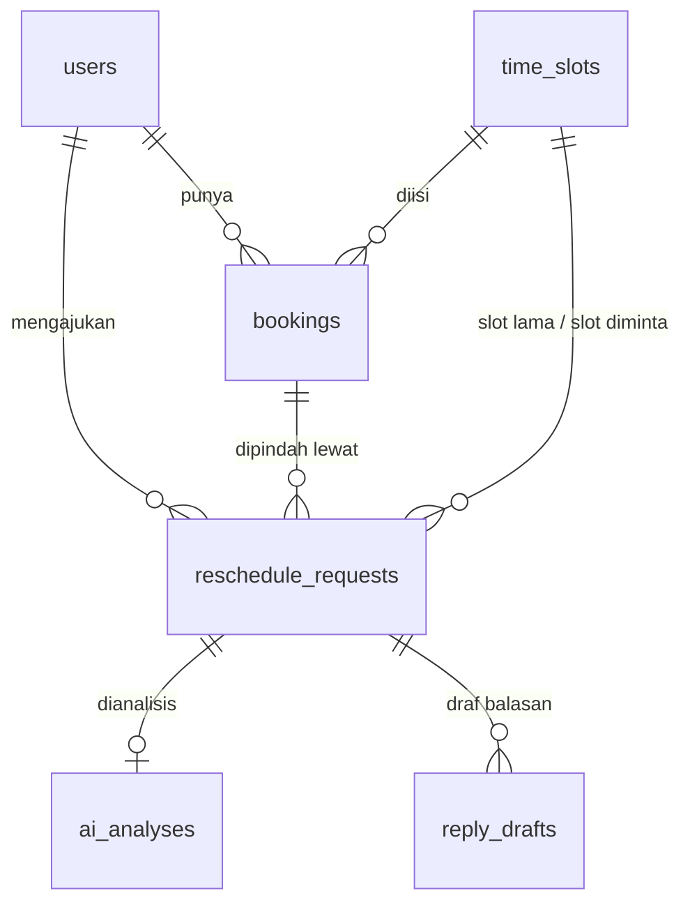

# Skema Database

PostgreSQL, dikelola dengan [node-pg-migrate](https://github.com/salsita/node-pg-migrate). Semua perubahan skema ada di [backend/migrations/](../backend/migrations/) dan dijalankan dengan `npm run migrate up` di folder `backend`.

## Relasi

## Tabel

### `users`
| Kolom | Tipe | Keterangan |
|---|---|---|
| id | serial PK | |
| name | varchar(100) | |
| email | varchar(255) unique | |
| phone | varchar(20) | Opsional |
| role | `user_role` | `customer` (default) atau `admin` |
| password_hash | text | bcrypt |
| created_at | timestamptz | |

### `time_slots`
| Kolom | Tipe | Keterangan |
|---|---|---|
| id | serial PK | |
| start_time | timestamptz unique | Satu slot per jam |
| end_time | timestamptz | Selalu `start_time + 1 jam` |
| session_type | varchar(50) | Default `Gym` (slot umum) |
| capacity | integer | Default dari `SLOT_CAPACITY` (20) |
| is_active | boolean | Default `true` |

Aturan slot dikunci dengan constraint `time_slots_hourly_rule`: mulai tepat di awal jam, antara 07:00 dan 20:00 WIB, dan berdurasi 1 jam. Constraint ini `NOT VALID`, jadi data lama tidak dicek ulang, tetapi semua slot baru wajib mengikutinya.

Slot dibuat otomatis oleh backend saat start dan setiap kali daftar slot diminta, untuk `SLOT_DAYS_AHEAD` hari ke depan (default 30). Slot yang sudah ada tidak diubah.

### `bookings`
| Kolom | Tipe | Keterangan |
|---|---|---|
| id | serial PK | |
| customer_id | FK → users | |
| slot_id | FK → time_slots | Berubah saat reschedule disetujui |
| status | `booking_status` | `active` atau `cancelled` |
| created_at | timestamptz | |
| cancelled_at | timestamptz | Diisi saat dibatalkan |

Satu member tidak bisa punya dua booking aktif di slot yang sama (index `unique_active_booking_per_slot`). Kapasitas dicek dalam transaksi dengan mengunci baris slot.

### `reschedule_requests`
| Kolom | Tipe | Keterangan |
|---|---|---|
| id | serial PK | |
| customer_id | FK → users | |
| booking_id | FK → bookings | |
| old_slot_id | FK → time_slots | Jadwal saat request diajukan, untuk riwayat |
| requested_slot_id | FK → time_slots | Slot tujuan |
| message | text | Pesan asli customer |
| status | `request_status` | `pending`, `approved`, `rejected`, `cancelled` |
| admin_note | text | Catatan admin yang dikirim ke member |
| reviewed_by | FK → users | Admin yang memutuskan |
| reviewed_at | timestamptz | |
| created_at | timestamptz | |

Satu booking hanya boleh punya satu request `pending` (index `unique_pending_request_per_booking`). Status `cancelled` dipakai jika member membatalkan booking sebelum request diputuskan; `admin_note` dibiarkan kosong karena bukan keputusan admin.

### `ai_analyses`
Hasil analisis AI untuk setiap request, satu baris per request.

| Kolom | Tipe | Keterangan |
|---|---|---|
| request_id | FK → reschedule_requests, unique | |
| intent | varchar(50) | Salah satu dari 5 intent |
| confidence | real | 0–1 |
| preferred_day | varchar(20) | Mis. `sabtu`, `besok`, `3 minggu lagi` |
| preferred_period | varchar(20) | `pagi`, `siang`, `sore`, `malam` |
| preferred_time | varchar(20) | Mis. `16:00`, `jam 8` |
| other_intents | text[] | Permintaan lain di pesan yang sama |

### `reply_drafts`
Draf balasan AI. Satu request bisa punya beberapa draf: draf awal saat diajukan, lalu draf setiap kali admin menekan tombol Draf AI. Yang ditampilkan adalah yang terbaru.

| Kolom | Tipe | Keterangan |
|---|---|---|
| request_id | FK → reschedule_requests | |
| draft_text | text | |
| source | varchar(20) | `gemini`, `fallback`, atau `low_confidence` |
| needs_review | boolean | `true` jika bukan hasil Gemini yang lolos validasi |

## Catatan migration

- `add-cancelled-request-status` berjalan di luar transaksi (`pgm.noTransaction()`), karena PostgreSQL tidak mengizinkan nilai enum baru dipakai di transaksi yang sama dengan saat nilai itu dibuat.
- Nilai enum tidak bisa dihapus di PostgreSQL. Saat rollback, data `cancelled` dikembalikan ke `rejected`.
